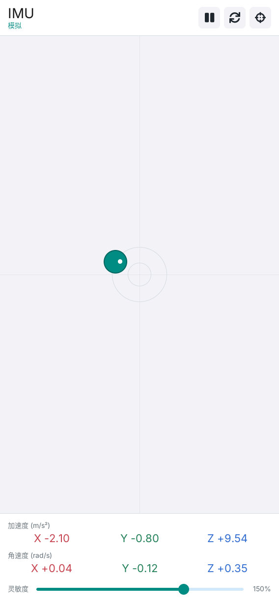
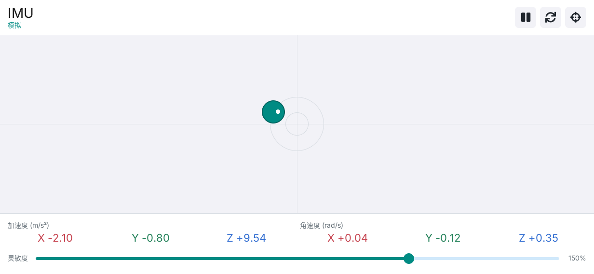

# LILYGO IMU

[English](README.md) | **简体中文**

LILYGO IMU 是面向 T-DisplayCM0 的六轴体感应用，基于 C++17、
[LILYGO UI AppKit](https://github.com/LILYGO-UI/cm0-appkit) 和 LVGL 9.5 构建。
应用通过 Linux IIO 读取板载 QMI8658B 的加速度与角速度，将板子倾斜姿态映射为
圆形区域内的小球位置，并显示实时六轴读数。

项目提供 CM0 ARM64 Linux 设备构建，以及用于开发和测试的 SDL2 桌面模拟器。
传感器功能无需联网。

## 预览

<p>
  
  
</p>

预览使用模拟输入，不代表实机验证。当前应用界面使用中文标签。

## 功能

- **姿态可视化：** 小球平滑跟随板子倾角，保持倾角时位置稳定，整个小球始终位于圆形边界内。
- **加速度反馈：** 突然加速时小球快速放大，最高为默认尺寸的 3 倍，空间不足时自动限幅，
  冲击结束后平滑恢复。
- **六轴读数：** 显示单位为 `m/s²` 的加速度和 `rad/s` 的角速度；
  小球上的白色标记响应绕传感器 Z 轴的转动。
- **运动控制：** 支持暂停/继续、复位、约一秒静止校准，以及 25% 到 200% 的灵敏度调节。
- **响应式布局：** 适配横屏、竖屏和小窗口；高度不足时优先保留运动区域和操作控件。
- **硬件与模拟数据源：** 后台读取 IIO，支持自动重连、过期数据检测，以及明确标识的模拟模式。

小球显示姿态和瞬时加速度反馈，不测量真实位移。校准结果仅在本次运行中有效。
详细说明见[传感器与校准](docs/02-sensor-and-calibration.md)（英文）。

## 操作

顶部按钮从左到右为暂停/继续、复位、校准。鼠标悬停或长按可查看名称。

| 控件 | 行为 |
| --- | --- |
| 暂停/继续 | 冻结小球位置、大小和白色标记；采样与六轴读数继续更新。恢复后跟随当前姿态。 |
| 复位 | 小球回到中央，恢复默认大小和标记角度。保留校准与灵敏度；继续更新后会回到当前倾角对应的位置。 |
| 校准 | 将板子保持在希望作为零位的姿态，静止约一秒。移动会重新累计；记录本次运行的零位方向和陀螺仪偏置。断连时不可用。 |
| 灵敏度 | 调整姿态到位置的响应幅度，范围 25% 到 200%，默认 100%。 |

状态显示为“实时”“模拟”“已暂停”“校准 N%”或“未连接”。断连后小球保持当前画面，
六轴读数显示为不可用，不会自动切换为模拟数据。

## 开发环境搭建

项目标识、版本和软件包元数据由 [`lpm.toml`](lpm.toml) 提供。
[`CMakePresets.json`](CMakePresets.json) 定义了 `host-simulator` 和 `cm0-cross`。
所有项目命令均在项目根目录执行。

### 源码依赖

如果使用 Git 仓库，先初始化锁定版本的 AppKit 和 Box2D 依赖：

```sh
git submodule update --init --recursive
```

如果使用不带 Git 元数据的源码副本，需确保 `third_party/cm0-appkit` 内容完整，
包括附带的 LVGL 源码归档和字体资源，并确保 `third_party/box2d` 内容完整。
模拟器直接使用此目录，无需单独安装 AppKit。
两种预设均使用其中的 LVGL 9.5.0 归档，并禁用 LVGL 网络下载。
Box2D 2.4.1 作为 Git 子模块固定版本，无需安装系统 Box2D 包。
详见[第三方源码说明](third_party/README.md)。

### 主机依赖

需要 CMake 3.24 或更高版本（包含 CTest 和 CPack）、Python 3.11 或更高版本，
以及支持 C++17 的 C/C++ 编译器。虽然工程声明的 CMake 最低版本为 3.21，
但 AppKit 附带的 LVGL 解压配置使用了 CMake 3.24 才引入的
`DOWNLOAD_EXTRACT_TIMESTAMP`。
预设使用 Unix Makefiles；AppKit 需要 `pkg-config`、SDL2、FreeType，
以及用于应用 LVGL 补丁的 `patch`。

#### Debian 12 / Ubuntu 24.04 或更高版本

```sh
sudo apt update
sudo apt install build-essential cmake git pkg-config patch libsdl2-dev \
  libfreetype6-dev ca-certificates python3 python3-venv python3-pip
```

较旧发行版需要先将 CMake 和 Python 升级到上述版本。

#### macOS

按需安装 Xcode Command Line Tools，并通过 [Homebrew](https://brew.sh/) 安装依赖。
完成 Homebrew 的 Shell 配置，确保工具位于 `PATH` 中：

```sh
xcode-select --install
brew install git cmake pkg-config patch sdl2 freetype python
```

#### LPM

CMake 在配置阶段调用 `lpm metadata --format cmake`。
在项目 Python 虚拟环境中安装 [LPM](https://github.com/LILYGO-UI/lpm)：

```sh
python3 -m venv .venv
. .venv/bin/activate
python -m pip install "git+https://github.com/LILYGO-UI/lpm.git"
lpm --version
```

每次打开新终端后，执行 `. .venv/bin/activate` 重新激活环境。
CMake 会同时搜索 `.venv/bin` 和 `PATH`；如需使用其他位置的 LPM，
可在配置时传入 `-DLPM_EXECUTABLE=/absolute/path/to/lpm`。

构建前检查环境：

```sh
cmake --version
python --version
pkg-config --modversion sdl2 freetype2
lpm metadata --format cmake
```

### 设备交叉编译器

仅开发桌面模拟器时可跳过此步骤。设备构建需要在开发机上安装 AArch64 Linux 交叉编译器。

**Debian / Ubuntu：**

```sh
sudo apt install gcc-aarch64-linux-gnu g++-aarch64-linux-gnu
```

**Apple Silicon macOS：**

```sh
brew install messense/macos-cross-toolchains/aarch64-unknown-linux-gnu
```

BSP 工具链要求 `PATH` 中存在以下名称的可执行文件：

```sh
aarch64-linux-gnu-gcc --version
aarch64-linux-gnu-g++ --version
```

SDK 对主机的要求详见 [CM0BspBuilder](https://github.com/LILYGO-UI/CM0BspBuilder)。
BSP 提供目标平台的头文件和库，但不会安装开发机所需的交叉编译器。

## 构建与测试

### 桌面模拟器

在支持的主机平台上显式启用模拟数据，构建并启动应用：

```sh
LILYGO_IMU_DEMO=1 lpm start --foreground
```

复用已有构建可执行 `LILYGO_IMU_DEMO=1 lpm start --no-build --foreground`。
Debug 构建启用测试，产物位于 `build/host-simulator`。交互式模拟器需要图形桌面会话。

不设置数据源环境变量时，macOS 默认使用模拟数据，Linux 默认尝试读取硬件。
Linux 无可访问的 IMU 时显示“未连接”。显式选择数据源的方法见[运行时配置](#运行时配置)。

### 测试

配置、构建并运行全部主机测试：

```sh
lpm test
```

| 测试 | 覆盖内容 |
| --- | --- |
| `imu-core` | 固定倾角稳定性、校准、陀螺仪输入、加速度冲击、圆形限位、旋转、IIO 换算、无效样本及重连 |
| `imu-view-model` | 用户命令、Subject 通知、连接状态和过期样本 |
| `imu-render-portrait` | `568 x 1232` 下的渲染和交互 |
| `imu-render-landscape` | `1232 x 568` 下的渲染和交互 |
| `imu-render-compact` | `320 x 480` 下的渲染和交互 |
| `imu-render-short` | `320 x 240` 下的渲染和交互 |

每项渲染测试在 `build/host-simulator` 下生成 `imu-<viewport>.ppm` 和
`imu-<viewport>-pulse.ppm`，使用合成传感器输入。
修改 UI 后应检查四种尺寸的常规与放大小球画面；断言通过不能替代视觉检查或实机验证。
详见 [UI 开发规范](docs/01-user-interface.md)。

### CM0 设备构建

交叉编译并生成 ARM64 Debian 软件包：

```sh
lpm pack
```

`cm0-cross` 预设面向 AArch64 架构的 CM0 Raspberry Pi OS，使用 Release 构建，
禁用主机测试，安装前缀为 `/usr`。首次配置时，
[工具链包装脚本](cmake/cm0-bsp-toolchain.cmake)会下载 CM0 BSP `0.1.0`，
校验锁定的 SHA-256，并解压到 `.cache/cm0-bsp/0.1.0/sysroot`。
首次下载需要访问 GitHub，后续配置复用缓存。
如需修改缓存根目录，在配置时传入 `-DCM0_BSP_CACHE_DIR=/absolute/path/to/cache`，
工具链会自动追加版本号和 `sysroot` 子目录。无需在相邻目录克隆 BSP 工程。

SDK sysroot 必须提供目标平台的头文件和库，包括 DRM 和 FreeType，
主机库不能替代缺失的目标依赖。CPack 将 `.deb` 输出到 `dist/`，
包含可执行文件、Launcher 条目及图标、桌面条目、AppStream 元数据和 Box2D/共享字体许可。
目标系统需提供 `libc6`、`libstdc++6`、`libdrm2`、`libfreetype6` 和
`lilygo-ui-appkit-dev >= 0.1.0`，其中 AppKit 提供共享运行时字体。

将生成的软件包传到设备后，在设备上安装并运行，版本变化时相应调整文件名：

```sh
sudo apt install ./lilygo-ui-imu_0.1.0_arm64.deb
lilygo-ui-imu
```

Launcher 中显示为 `IMU`，包名和可执行文件为 `lilygo-ui-imu`，应用 ID 为 `cc.lilygo.ui.Imu`。
设备显示/输入权限及 Launcher 退出手势遵循 AppKit 的 DRM/KMS 运行时。

<details>
<summary>底层 CMake 命令</summary>

LPM 封装了以下步骤。直接使用 CMake 时，读取项目元数据仍需要 LPM。

主机构建与测试：

```sh
cmake --preset host-simulator
cmake --build --preset host-simulator --parallel
ctest --preset host-simulator
```

设备构建与打包：

```sh
cmake --preset cm0-cross
cmake --build --preset cm0-cross --parallel
cpack --config build/cm0-cross/CPackConfig.cmake -B dist
```

</details>

## 运行时配置

板载 QMI8658B 位于 `i2c1`，地址为 `0x6a`。板级 overlay 使用 `qst,qmi8658c`
兼容驱动，因此 IIO 名称通常为 `qmi8658c`。应用也会在 `/sys/bus/iio/devices`
下识别 `qmi8658b` 和 `qmi8658`。运行用户需具备 raw 通道与 scale 属性的读取权限；
应用不直接访问 I2C，也不重新配置芯片。

| 环境变量 | 行为 |
| --- | --- |
| `LILYGO_IMU_DEMO` | 精确值 `1` 强制模拟，优先于设备路径；其他任何已设置值都选择 IIO。未设置时 Linux 使用 IIO；macOS 在未设置 `LILYGO_IMU_DEVICE` 时使用模拟。 |
| `LILYGO_IMU_DEVICE` | 指定 IIO 设备目录。空值使用自动搜索，同时也会关闭 macOS 默认模拟。 |
| `LILYGO_IMU_ROTATION` | 以整数角度设置额外平面旋转，叠加到 AppKit 显示旋转上。默认 `0`，通常取 `0`、`90`、`180`、`270`；六轴读数始终保留传感器坐标。 |

主机构建完成后可使用：

```sh
# 指定 IIO 设备；macOS 也可指定包含同名属性的测试目录
LILYGO_IMU_DEMO=0 LILYGO_IMU_DEVICE=/sys/bus/iio/devices/iio:device0 \
  ./build/host-simulator/lilygo-ui-imu

# 在没有 IMU 的主机上检查未连接状态
LILYGO_IMU_DEMO=0 lpm start --no-build --foreground

# 为设备上已安装的应用增加安装方向旋转
LILYGO_IMU_ROTATION=90 lilygo-ui-imu
```

当前驱动使用 direct mode 逐轴读取，并非硬件同步的六轴帧。
后台每次成功读取后等待约 10 ms，UI 约每 16 ms 更新一次。
读取失败后约每秒尝试重新连接，样本超过 250 ms 未更新时停止小球运动。
单位换算、采样时序、校准细节和诊断方法见[传感器与校准](docs/02-sensor-and-calibration.md)（英文）。

## 常见问题

| 现象 | 处理方法 |
| --- | --- |
| `lpm is required to read project metadata` | 在 `.venv` 中安装 LPM，将其加入 `PATH`，或设置 `LPM_EXECUTABLE`。 |
| 缺少 `LilyGoUI`、LVGL 或 Box2D 源码 | Git 仓库先初始化两个子模块；源码副本需包含完整的 `third_party/cm0-appkit` 和 `third_party/box2d`。 |
| 缺少 SDL2 或 FreeType | 安装主机开发依赖；交叉编译时检查目标 sysroot。 |
| 找不到 Homebrew 库 | 使用 `cmake --preset host-simulator -DCMAKE_PREFIX_PATH="$(brew --prefix)"` 配置。 |
| BSP 下载或交叉编译器查找失败 | 检查 GitHub 访问、磁盘空间，以及 `PATH` 中是否存在 `aarch64-linux-gnu-gcc` 和 `aarch64-linux-gnu-g++`。 |
| 始终显示“未连接” | 检查板级 overlay/驱动、IIO 路径及读取权限；以前台模式查看 IIO 诊断，详见[传感器说明](docs/02-sensor-and-calibration.md)（英文）。 |
| 小球偏离中心或方向不符 | 静止校准，然后检查显示旋转与 `LILYGO_IMU_ROTATION`。单独复位不会改变零位。 |
| 校准进度反复清零 | 保持板子静止约一秒；持续变化的模拟数据不能作为静止校准参考。 |

## 文档

| 指南 | 内容 |
| --- | --- |
| [传感器与校准](docs/02-sensor-and-calibration.md)（英文） | IIO 通道、数据源、采样时序、姿态映射、校准和诊断 |
| [架构概览](docs/00-overview.md) | 模块边界、后台线程、数据流和构建集成 |
| [UI 开发规范](docs/01-user-interface.md) | 布局、状态显示、字体、所有权和验证要求 |

## 致谢

界面使用 LILYGO UI AppKit 和 [LVGL](https://lvgl.io/)。
[Box2D](https://github.com/erincatto/box2d) 提供模型中的二维向量与旋转运算。
安装包包含其 MIT 许可证及 AppKit 共享字体的许可声明。
